<p align="center">
  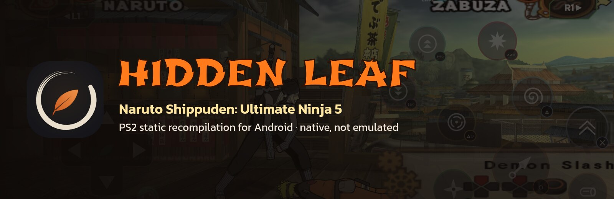
</p>

<p align="center">
  <a href="https://github.com/dfdx047/HiddenLeaf/releases"></a>
  <a href="https://github.com/dfdx047/HiddenLeaf/releases"></a>
  
  
  
</p>

<p align="center">
  <a href="README.md">English</a> · <a href="README.pt-BR.md">Português</a> · <b>Español</b>
  <br>
  <a href="CHANGELOG.es.md">Changelog</a> · <a href="https://github.com/dfdx047/HiddenLeaf/releases">Versiones</a>
</p>

**Hidden Leaf** ejecuta *Naruto Shippuden: Ultimate Ninja 5* (PlayStation 2) de forma nativa en Android. El código del
propio juego fue **recompilado estáticamente** de MIPS a ARM64 con [PS2Recomp](https://github.com/ran-j/PS2Recomp): no
hay CPU emulada, el juego corre como una app de Android. Encima va un launcher hecho para móviles y portátiles,
controles táctiles hechos para este juego, mods y **juego en línea**: salas, partida rápida y Wi-Fi local, elegidos desde
el propio menú del juego.

> [!IMPORTANT]
> Proyecto de fans, sin relación con Bandai Namco ni CyberConnect2. **La app no trae ningún dato del juego** (ni imagen
> del disco, modelos, texturas, sonidos, voces o vídeos). Necesitas tu propia copia de la versión europea,
> *Naruto Shippuden: Ultimate Ninja 5* (SLES-55605), en ISO.

## Imágenes

<p align="center">
  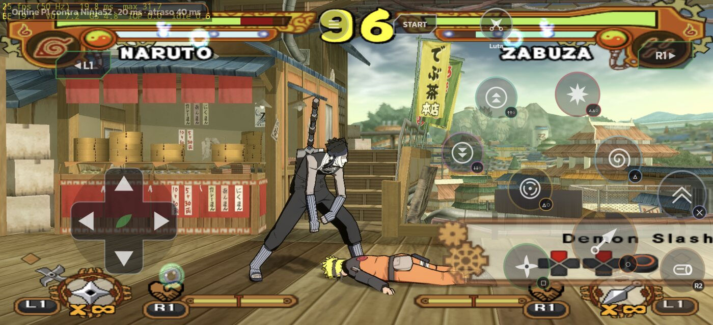
  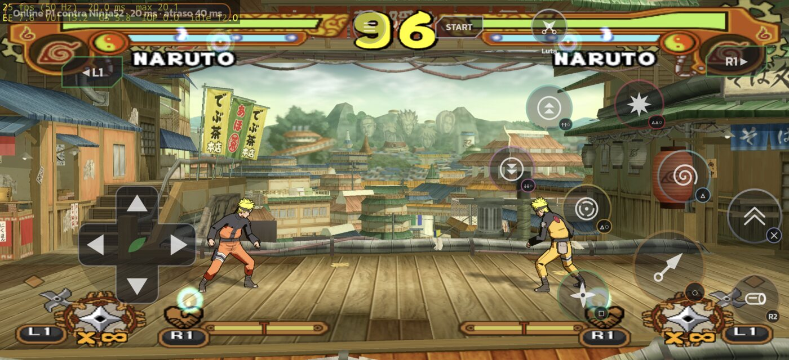
  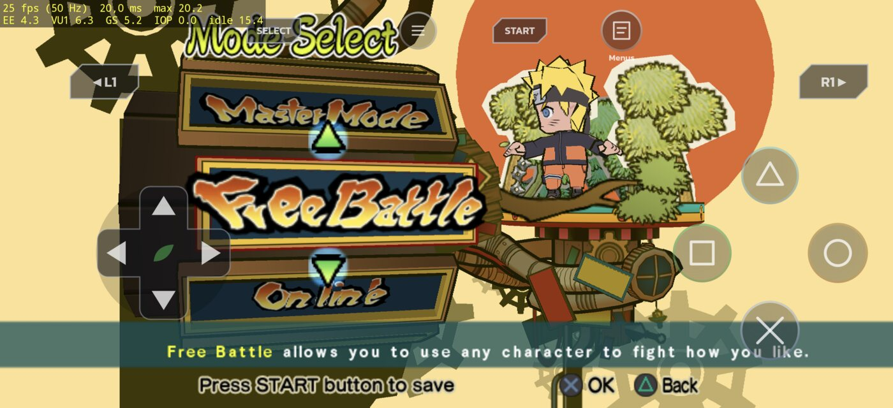
  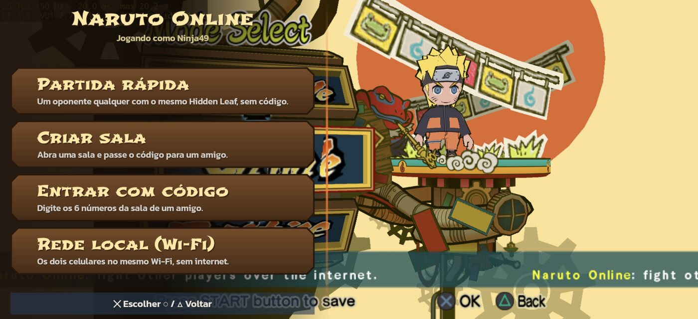
  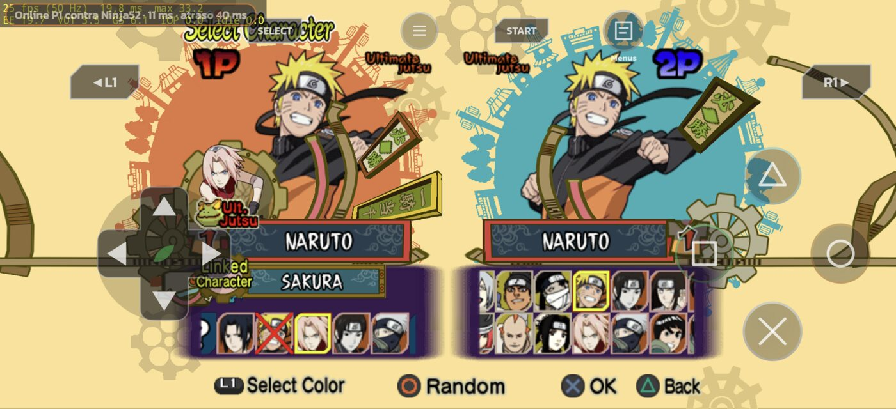
  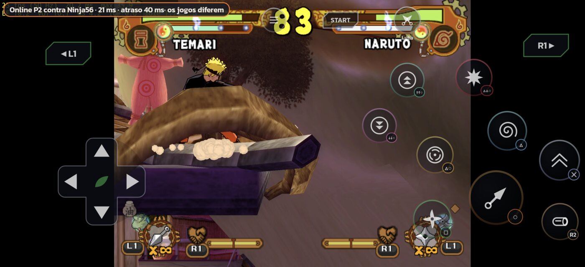
</p>

**Mods** (Ultimate Ninja 6 Alpha 1.1X):

<p align="center">
  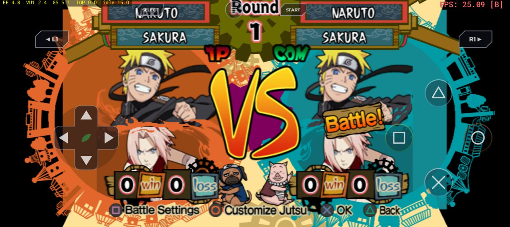
  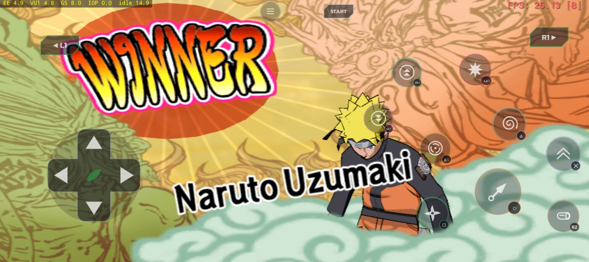
</p>

**Launcher y controles:**

<p align="center">
  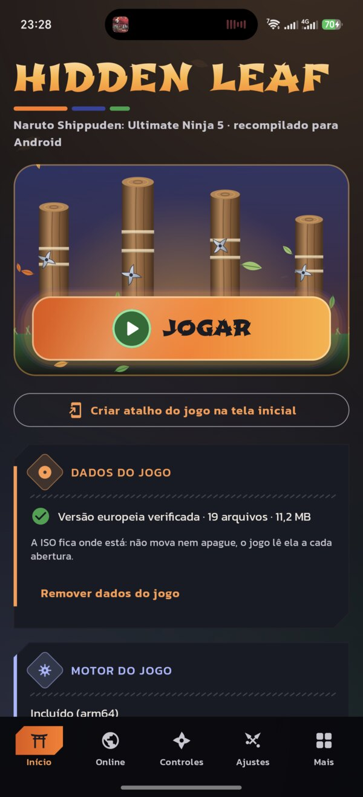
  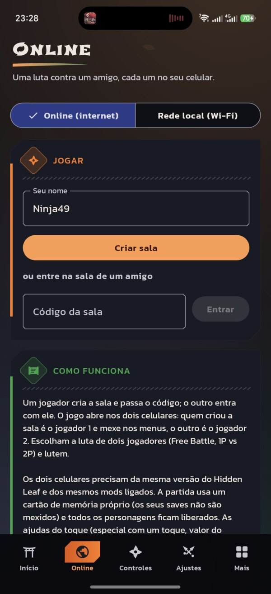
  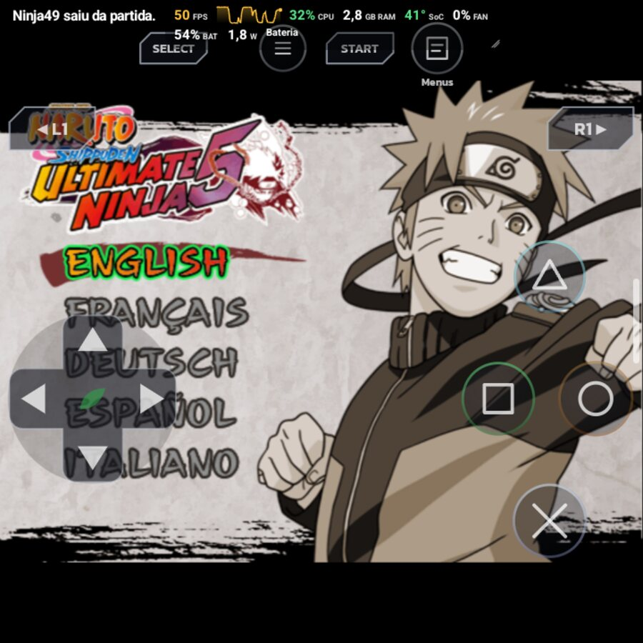
</p>
<p align="center">
  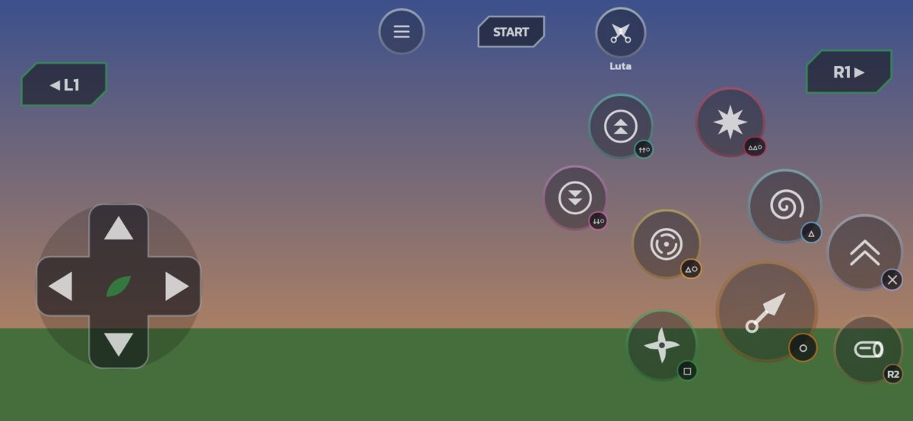
  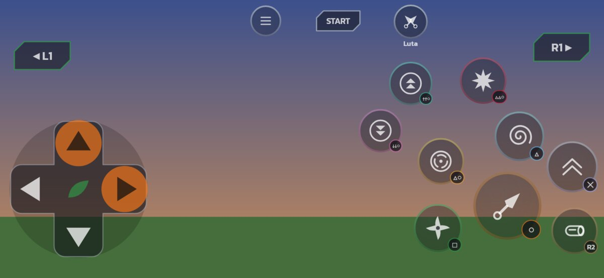
  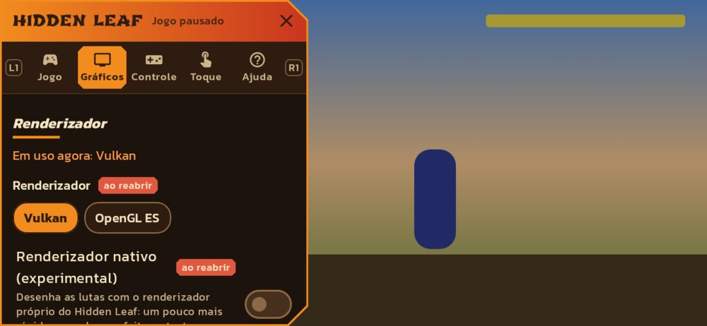
  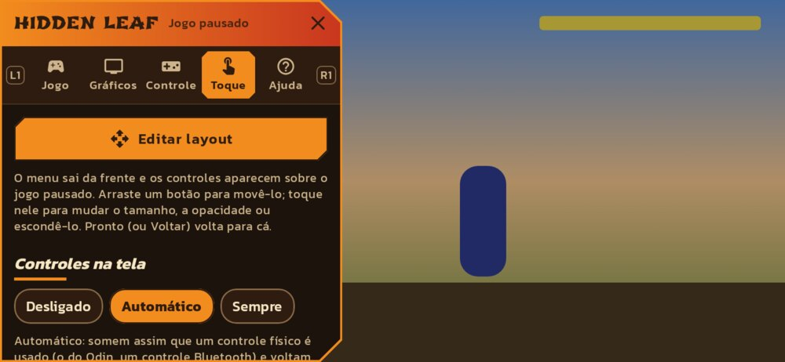
</p>

## Qué incluye

- **Nativo, no emulado.** El ELF del juego y los overlays de `PRG/` (combate, aventura, menús, textos) corren como
  código ARM64. Los combates corren a los 50 fps de PS2; en móviles de la clase Snapdragon 665, el modo ligero deja
  margen para ello.
- **Dos motores en un solo APK:** ARMv8.2-A para chips nuevos y ARMv8.0-A para los antiguos (clase Snapdragon 625/665);
  la app elige el adecuado.
- **Gráficos:** el GS de PS2 de ARMSX2/PCSX2 sobre Vulkan u OpenGL ES, resolución interna de 0,5x a 8x, **Widescreen
  (16:9)** y **Ultrawide (20:9)** en combates, campaña y menús sin estirar el HUD, 30/50 fps y 60/90/120 fps por
  interpolación, drivers Adreno personalizados (Turnip) descargados con un toque y un **modo ligero** para móviles más
  modestos.
- **Controles táctiles hechos para Ultimate Ninja 5:** un diseño por escena (combate, campaña, menús), especiales de un
  toque (↑↑○ y ↓↓○), Jutsu y Ougi en un solo botón, **Toque Pro** con cruceta grande y fija, macros, guía de botones y
  editor de diseño (tamaño, posición y opacidad). Un mando físico se detecta y oculta los botones en pantalla; si se
  desconecta, los botones vuelven.
- **Menú lateral dentro del juego** (sin salir del juego): gráficos, mapeo del mando, diseño táctil y ayuda.
- **En línea como en Dragon Rage, dentro del menú del juego:** *Naruto Online* está en Mode Select, debajo de Free
  Battle. El panel se abre junto al Naruto animado, con la música sonando, y funciona con toque o mando:
  - **Partida rápida:** cualquier otro jugador con la misma versión de Hidden Leaf, sin código.
  - **Crear sala / Entrar con código:** un código de 6 números para un amigo.
  - **Red local (Wi-Fi):** dos móviles en el mismo Wi-Fi o punto de acceso, sin internet.
  - Los dos móviles van directo a la selección de personaje (1P y 2P), sin sonido y acelerados por los menús. Quien
    crea elige el escenario y los menús; quien entra controla al 2P.
  - Lockstep con retardo de entrada por conexión directa (STUN), con relay cuando la conexión directa no es posible.
- **Mods:** importa la ISO de un mod y la app guarda solo los archivos que difieren del juego base. Mods conocidos:
  **Ultimate Ninja 6 (Alpha 3.5)** con su propio paquete de código recompilado, **Ultimate Ninja 6 (Alpha 1.1X)** y la
  **Versão Brasileira**.
- **Launcher:** comprobación de la ISO por SHA-256, gestor de tarjeta de memoria (importar y exportar `.ps2` con copia
  de seguridad), trucos (desbloqueos escritos en la partida guardada), saltar la intro, acceso directo en la pantalla de
  inicio, portugués, inglés y español.

## Instalar y jugar

1. Descarga `HiddenLeaf-v0.1.0-beta.apk` en [Versiones](https://github.com/dfdx047/HiddenLeaf/releases) e instálalo
   (Android 10 o superior, ARM de 64 bits).
2. Abre Hidden Leaf, toca **Elegir ISO** y elige tu *Naruto Shippuden: Ultimate Ninja 5* (Europa, SLES-55605). La
   app la comprueba y copia solo los archivos pequeños de arranque; el resto se lee de la ISO donde está.
3. Toca **JUGAR**.
4. En línea: en el juego, *Free Battle* → *Naruto Online*. Los dos jugadores necesitan la misma versión de Hidden Leaf y
   el juego base (sin mods).

Opcional: en la página **Mods**, importa la ISO de un mod compatible y actívalo.

## Cómo funciona

```
tu ISO    ──► SYSTEM.CNF, ELF, overlays de PRG/        (leídos en el móvil, nunca distribuidos)
                 │
PS2Recomp ──► C++ para cada función MIPS del ELF y de cada overlay
                 │                  (8158 funciones en el ELF; BTL 2832, ADV 3679, ETC 253; 0 errores)
NDK clang ──► libun5.so  (arm64, ARMv8.2 y ARMv8.0)  +  paquetes de código de los mods
                 │
runtime   ──► hilos y planificador del EE, módulos del IOP, SIF/RPC, DMA, VIF1/VU1, sonido del SPU2,
              vídeos MPEG, mando, tarjeta de memoria, lectura del disco directa de la ISO
                 │
GS        ──► el GS de ARMSX2/PCSX2 (Vulkan / GLES); renderizador nativo de combate opcional
```

- **Recompilación.** `tools/un5.py prepelf` divide la sección única del ELF en código y datos para que el recompilador
  vea solo funciones reales; los overlays se recompilan como módulos propios y se encuentran en tiempo de ejecución por
  sus bytes en memoria.
- **Runtime.** El runtime de PS2Recomp, ampliado para este juego: módulos reales del IOP (`libsd`, `sdr_driver`,
  `modmidi`, `modhsyn`, `cdvdstm`), tiempos de lectura del disco, la organización del heap de PS2, el redondeo de la FPU
  del EE, hilos fijados según la velocidad de los núcleos, el IOP y el SPU2 en un hilo propio.
- **Comprobado contra PCSX2.** Un banco de pruebas ejecuta la misma ruta de botones en PCSX2 y en el juego recompilado
  y compara estructuras de la RAM, el flujo del GS y los fotogramas, combate a combate.
- **VU1.** Por defecto la VU1 del runtime; en modo ligero, los bloques de VU1 recompilados de **Nominum-Render**
  (nuestro renderizador nativo de PS2 para recomps).
- **Mods.** `tools/un5.py diff` compara el código de un mod con el de la base, función por función. Un mod de datos
  corre en el motor base; un mod que cambia el código recibe un paquete de código (UN6 Alpha 3.5 cambia unas 630
  funciones y añade unas 770).
- **En línea.** El juego es determinista con las mismas entradas, así que los dos móviles ejecutan el juego completo e
  intercambian solo los botones, en lockstep con un pequeño retardo. Las salas y la partida rápida están en un
  Cloudflare Worker con base de datos D1; la conexión es directa (STUN, UDP), con relay de respaldo. En Wi-Fi, los
  móviles se encuentran por broadcast. La entrada a la partida (arranque, menús, selección de personaje) va acelerada y
  sin sonido en los dos móviles.

## Nuestra trayectoria

| Cuándo | Qué pasó |
|---|---|
| 25/10/2026 | Inicio: launcher a partir de la plantilla de Dragon Rage, análisis del ELF y de los overlays, cadena de recompilación. La primera ejecución en PC llegó al arranque del IOP. |
| 25–26/10 | Módulos del IOP cargados de verdad, búsqueda de archivos en el disco, vídeos con FFmpeg, matemáticas de VU0/VU1, vblank PAL de 50 Hz. La pantalla de título se dibuja (la causa era el `DI` ignorado). |
| 01/11 | Primera ejecución en Android: GS de PCSX2 sobre Vulkan, ISO leída por descriptor de archivo; sonido del SPU2; VIF1/VU1/GIF en un hilo propio; renderizador nativo de combate. Combates a 50 fps. |
| 02–03/11 | Panel de pausa, widescreen, 60/120 fps interpolados, gestor de tarjeta de memoria, mods sobre la imagen del disco y paquetes de código; UN6 Alpha 3.5 combate en la RG Cube. |
| 04–05/11 | Nominum-Render probado en los dispositivos, volcados del VIF, libsdr recompilada, sonido de los vídeos en orden, congelación del Ougi corregida; A35 y Alpha 1.1X en tres dispositivos. |
| 08–09/11 | Banco contra PCSX2: redondeo, rand, tiempos del disco y envíos de PATH3 iguales a los de PS2. Menús táctiles, menús en 20:9, motor ARMv8.0, heap igual al de PS2. |
| 10–11/11 | IOP en bloques predecodificados, ajustes en el Mi A3 (Snapdragon 665), nombres Widescreen/Ultrawide, 0,5x y 0,75x. |
| 12/11 | GS como renderizador por defecto, launcher con cinco páginas, trucos, Toque Pro, menú lateral, servicio de salas en línea (Cloudflare Worker + D1) y lockstep en el motor. |
| 13/11 | Modo ligero (VU1 de Nominum + GS dividido), icono nuevo, despertar de Hinata corregido, juego por Wi-Fi local, partida rápida. |
| 14/11 | La entrada a la partida por el lockstep, *Naruto Online* en el Mode Select del juego, combates completos en línea por red local e internet. **v0.1.0-beta.** |

El registro completo, build a build, está en [docs/registro.md](docs/registro.md) (en portugués).

## Dispositivos probados

Móviles Honor y Poco (20:9), Xiaomi Mi A3 (Snapdragon 665), Anbernic RG Cube (Mali, 1:1), AYN Odin 2 Mini, AYN Odin 3
(120 Hz) y Retroid Pocket 5 (Snapdragon 865). El juego en línea se probó Honor × Poco por internet (salas, código,
partida rápida) y por Wi-Fi local.

## Problemas conocidos

- **Beta.** Algunos efectos todavía pueden diferir de PS2; el modo ligero puede perder o hacer parpadear algunos efectos.
- **Los paquetes de texturas** se pueden instalar, pero el juego todavía no los usa.
- **El juego en línea es solo para el juego base** (sin mods) y necesita la misma versión de Hidden Leaf en los dos
  móviles. El servidor gratuito tiene una cuota diaria; cuando se agota, la página de inicio avisa cuándo vuelve
  (medianoche UTC). El Wi-Fi local no usa el servidor.
- Los mods que cambian el código solo corren con su paquete de código (hoy: UN6 Alpha 3.5).

Errores y registros: abre un [issue](https://github.com/dfdx047/HiddenLeaf/issues). La página *Depuración* guarda un
registro para enviar.

## Compilar

El motor se genera a partir de tu propio ELF; nada del juego entra en este repositorio.

```sh
# PC (Linux): ISO → disco extraído → ELF dividido → PS2Recomp → código generado → runtime
recomp/build.sh <tu ISO europea de UN5> --run

# Motor de Android (libun5.so; HL_V80=1 para ARMv8.0; --mod <id> para el paquete de código de un mod)
recomp/android/build.sh
HL_V80=1 recomp/android/build.sh

# Launcher
cd android && ./gradlew assembleRelease
```

Herramientas: `tools/un5.py` (`verify`, `extract`, `overlays`, `diff`, `unpack`, `prepelf`, `ovlelf`),
`tools/ramdiff.py`, `tools/vifdump.py`. Notas técnicas (en portugués): [docs/plano.md](docs/plano.md),
[docs/analise-elf.md](docs/analise-elf.md), [docs/online.md](docs/online.md).

## Créditos

- [PS2Recomp](https://github.com/ran-j/PS2Recomp), de ran-j: el recompilador estático y su runtime.
- [ARMSX2](https://github.com/ARMSX2/ARMSX2) y [PCSX2](https://github.com/PCSX2/pcsx2): el renderizador del GS y la
  referencia contra la que se comprueba todo.
- **Nominum-Render**: nuestro renderizador nativo de PS2 para recomps (VU1 y VIF1).
- [Dragon Rage](https://github.com/dfdx047/Tenkaichi3DecompAndroid): la plantilla del launcher y el diseño del juego en
  línea.
- [SDL3](https://github.com/libsdl-org/SDL), [FFmpeg](https://ffmpeg.org), [ReLinker](https://github.com/KeepSafe/ReLinker),
  Jetpack Compose, Cloudflare Workers y D1.
- Los equipos de los mods UN6 y Versão Brasileira, por los mods que los jugadores pueden importar.

*Naruto* es © Masashi Kishimoto / Shueisha, TV Tokyo, Pierrot. *Naruto Shippuden: Ultimate Ninja 5* es © Bandai Namco
Entertainment y CyberConnect2. Todas las marcas pertenecen a sus dueños.
