<p align="center">
  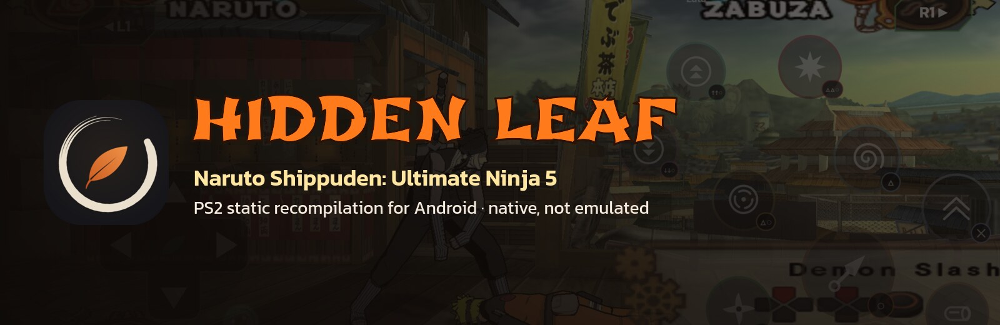
</p>

<p align="center">
  <a href="https://github.com/dfdx047/HiddenLeaf/releases"></a>
  <a href="https://github.com/dfdx047/HiddenLeaf/releases"></a>
  
  
  
</p>

<p align="center">
  <b>English</b> · <a href="README.pt-BR.md">Português</a> · <a href="README.es.md">Español</a>
  <br>
  <a href="CHANGELOG.md">Changelog</a> · <a href="https://github.com/dfdx047/HiddenLeaf/releases">Releases</a>
</p>

**Hidden Leaf** runs *Naruto Shippuden: Ultimate Ninja 5* (PlayStation 2) natively on Android. The game's own code was
**statically recompiled** from MIPS to ARM64 with [PS2Recomp](https://github.com/ran-j/PS2Recomp): there is no emulated
CPU, the game runs as an Android app. On top of it comes a launcher made for phones and handhelds, touch controls made
for this game, mods, and **online play**: rooms, quick match and local Wi-Fi, chosen right from the game's own menu.

> [!IMPORTANT]
> A fan project, not affiliated with Bandai Namco or CyberConnect2. **The app carries no game data** (no disc image,
> models, textures, sounds, voices or films). You need your own copy of the European release,
> *Naruto Shippuden: Ultimate Ninja 5* (SLES-55605), as an ISO.

## Screenshots

<p align="center">
  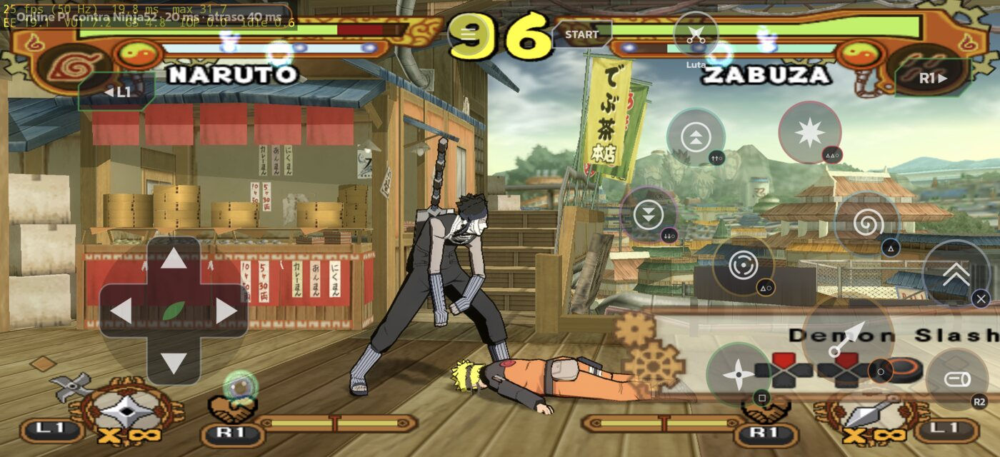
  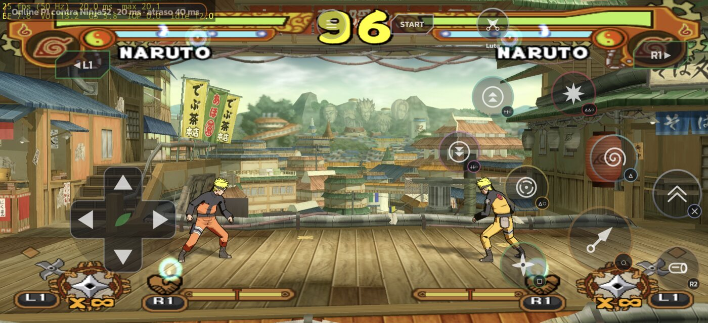
  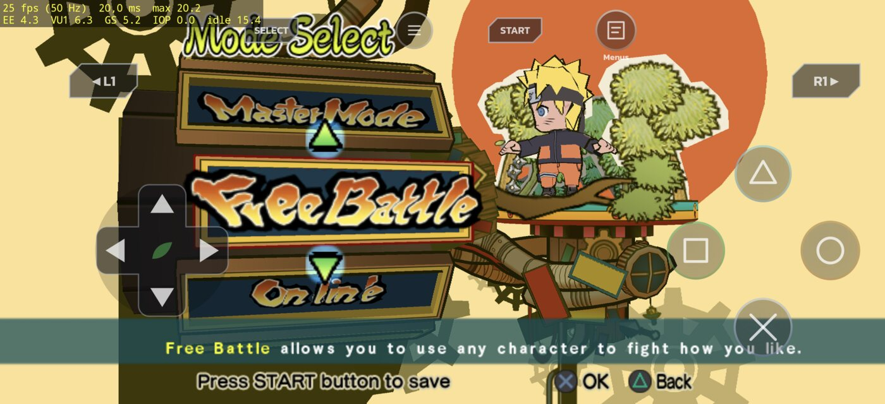
  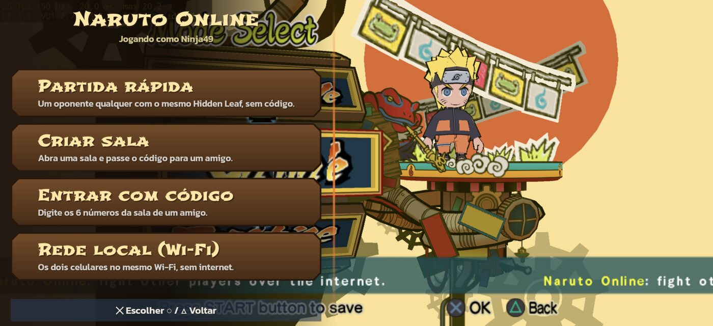
  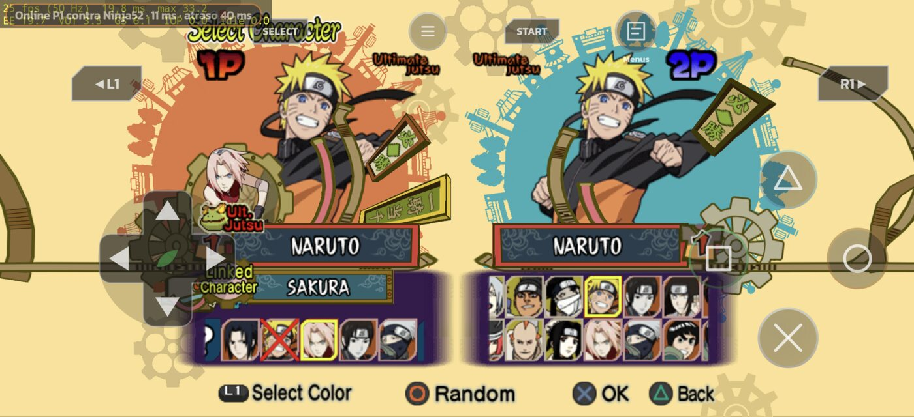
  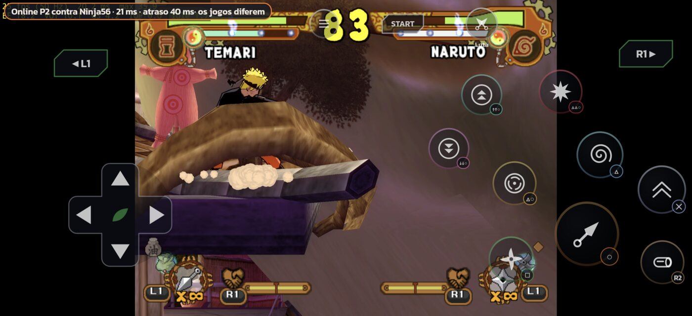
</p>

**Mods** (Ultimate Ninja 6 Alpha 1.1X):

<p align="center">
  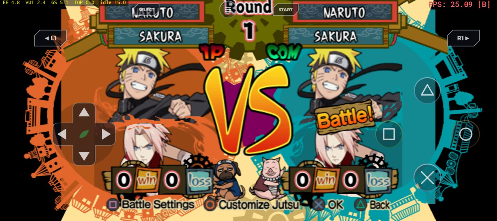
  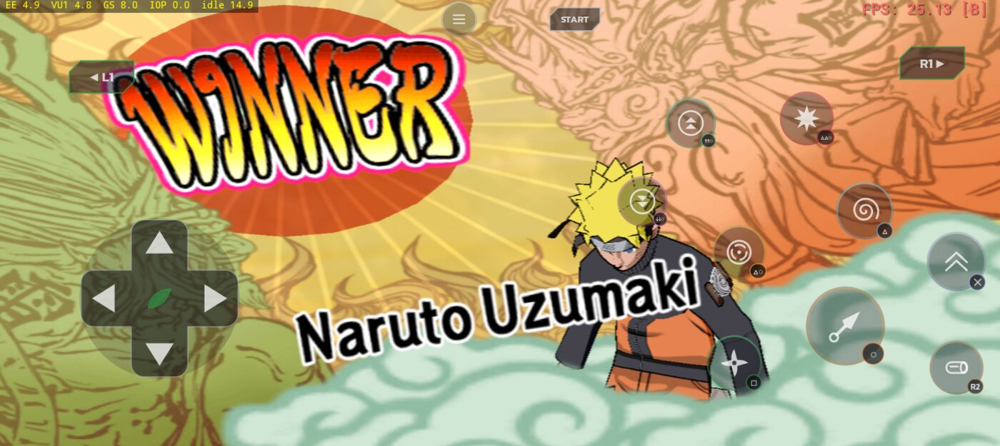
</p>

**Launcher and controls:**

<p align="center">
  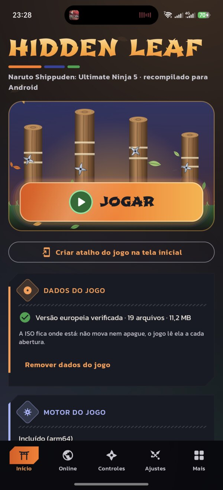
  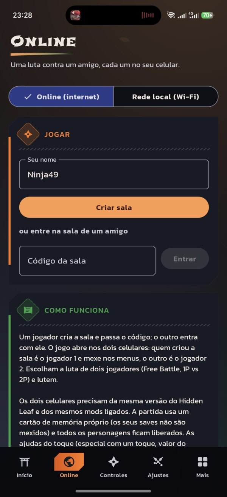
  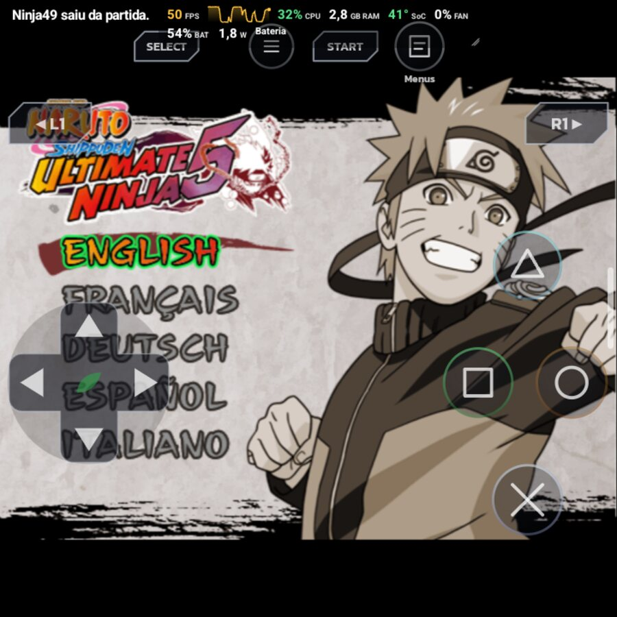
</p>
<p align="center">
  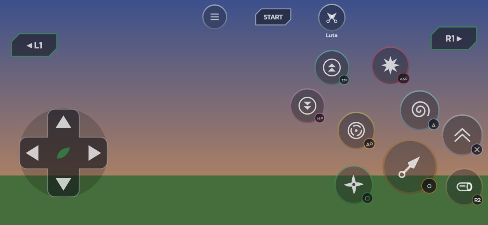
  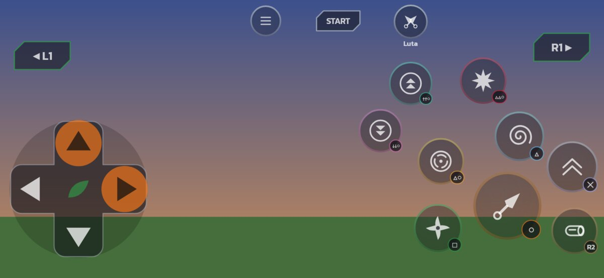
  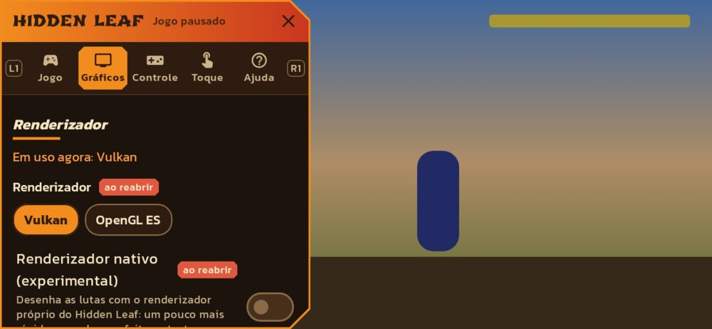
  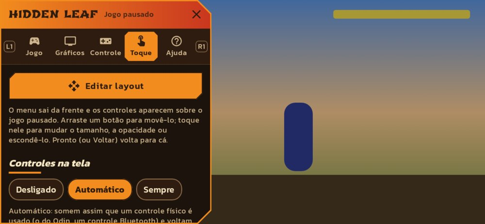
</p>

## Features

- **Native, not emulated.** The game's ELF and its `PRG/` overlays (fight, adventure, menus, texts) run as ARM64
  code. Fights run at the PS2's 50 fps; on Snapdragon 665 class phones, light mode leaves room for it.
- **Two builds in one APK:** ARMv8.2-A for newer chips and ARMv8.0-A for older ones (Snapdragon 625/665 class); the app
  picks the one that fits.
- **Graphics:** the PS2 GS from ARMSX2/PCSX2 over Vulkan or OpenGL ES, internal resolution from 0.5x to 8x,
  **Widescreen (16:9)** and **Ultrawide (20:9)** in fights, campaign and menus without stretching the HUD, 30/50 fps and
  60/90/120 fps by interpolation, custom Adreno drivers (Turnip) downloaded in one tap, and a **light mode** for weaker
  phones.
- **Touch controls made for Ultimate Ninja 5:** a layout per scene (fight, campaign, menus), one-touch specials
  (↑↑○ and ↓↓○), one-button Jutsu and Ougi, **Toque Pro** with a large fixed D-pad, macros, a button guide, and a layout
  editor for size, position and opacity. A physical controller is detected and hides the touch buttons; if it
  disconnects, the touch buttons come back.
- **In-game side menu** (no need to leave the game): graphics, controller mapping, touch layout and help.
- **Online like Dragon Rage, inside the game's menu:** *Naruto Online* sits in Mode Select under Free Battle. The panel
  opens beside the animated Naruto, with the music still playing, and works by touch or controller:
  - **Quick match:** anyone else on the same version of Hidden Leaf, no code needed.
  - **Create room / Enter code:** a 6-digit code for a friend.
  - **Local network (Wi-Fi):** two phones on the same Wi-Fi or hotspot, no internet needed.
  - Both phones go straight to the character select (1P and 2P), muted and fast-forwarded through the menus. The
    host picks the stage and the menus; the guest controls 2P.
  - Lockstep with input delay over a direct connection (STUN), with a relay when a direct link is not possible.
- **Mods:** import a mod's ISO and the app keeps only the files that differ from the base game. Known mods:
  **Ultimate Ninja 6 (Alpha 3.5)** with its own recompiled code pack, **Ultimate Ninja 6 (Alpha 1.1X)** and the
  **Versão Brasileira**.
- **Launcher:** ISO check by SHA-256, memory card manager (`.ps2` import and export with backup), cheats (unlocks
  written to the save), skip intro, home screen shortcut, Portuguese, English and Spanish.

## Install and play

1. Download `HiddenLeaf-v0.1.0-beta.apk` from [Releases](https://github.com/dfdx047/HiddenLeaf/releases) and
   install it (Android 10 or newer, 64-bit ARM).
2. Open Hidden Leaf, tap **Choose ISO** and pick your *Naruto Shippuden: Ultimate Ninja 5* (Europe, SLES-55605). The
   app checks it and copies only the small boot files; the rest is read from the ISO where it is.
3. Tap **PLAY**.
4. Online: in the game, *Free Battle* → *Naruto Online*. Both players need the same version of Hidden Leaf and the base
   game (no mods).

Optional: on the **Mods** page, import the ISO of a supported mod and turn it on.

## How it works

```
your ISO ──► SYSTEM.CNF, ELF, PRG/ overlays          (read on the phone, never shipped)
                 │
PS2Recomp ──► C++ for each MIPS function of the ELF and of each overlay
                 │                  (8158 ELF functions; BTL 2832, ADV 3679, ETC 253; 0 errors)
NDK clang ──► libun5.so  (arm64, ARMv8.2 and ARMv8.0)  +  code packs for mods
                 │
runtime   ──► EE threads and scheduler, IOP modules, SIF/RPC, DMA, VIF1/VU1, SPU2 sound,
              MPEG films, pad, memory card, disc reads straight from the ISO
                 │
GS        ──► ARMSX2/PCSX2's GS (Vulkan / GLES); optional native fight renderer
```

- **Recompilation.** `tools/un5.py prepelf` splits the ELF's single section into code and data so the recompiler sees
  only real functions; overlays are recompiled as their own modules and found at run time by the bytes in memory.
- **Runtime.** PS2Recomp's runtime, extended for this game: real IOP modules (`libsd`, `sdr_driver`, `modmidi`,
  `modhsyn`, `cdvdstm`), disc timing, the PS2's heap layout, the EE FPU's rounding, threads pinned by core speed, the
  IOP and SPU2 on their own thread.
- **Checked against PCSX2.** A bench runs the same button route on PCSX2 and on the recompiled game and compares RAM
  structures, the GS stream and the frames, fight by fight.
- **VU1.** By default the runtime's VU1; in light mode, **Nominum-Render**'s recompiled VU1 blocks (our own native
  renderer project for PS2 recomps).
- **Mods.** `tools/un5.py diff` compares a mod's code with the base function by function. A data mod runs on the base
  engine; a mod that changes code gets a code pack (UN6 Alpha 3.5 changes about 630 functions and adds about 770).
- **Online.** The game is deterministic for the same inputs, so both phones run the full game and exchange only the
  pad inputs, in lockstep with a small input delay. Rooms and quick match live on a Cloudflare Worker with a D1
  database; the connection is direct (STUN, UDP) with a relay as fallback. On Wi-Fi, phones find each other by
  broadcast. The way into the match (boot, menus, character select) is fast-forwarded and muted on both phones.

## Our path

| When | What happened |
|---|---|
| Oct 25, 2026 | Project start: launcher from the Dragon Rage template, ELF and overlay analysis, recompilation pipeline. First PC run reached the IOP boot. |
| Oct 25–26 | IOP modules loaded for real, disc file search, movies with FFmpeg, VU0/VU1 math, 50 Hz PAL vblank. The title screen draws (the cause was `DI` being ignored). |
| Nov 1 | First run on Android: PCSX2's GS over Vulkan, reading the ISO by file descriptor; SPU2 sound; VIF1/VU1/GIF on their own thread; a native fight renderer. Fights at 50 fps. |
| Nov 2–3 | Pause panel, widescreen, 60/120 fps interpolation, memory card manager, mods over the disc image and code packs; UN6 Alpha 3.5 fights on the RG Cube. |
| Nov 4–5 | Nominum-Render tested on devices, VIF dumps, libsdr recompiled, film sound in order, Ougi freeze fixed; A35 and Alpha 1.1X on three devices. |
| Nov 8–9 | PCSX2 comparison bench: rounding, rand, disc timing, PATH3 uploads made equal to the PS2. Touch menus, 20:9 menus, ARMv8.0 build, heap matching the PS2. |
| Nov 10–11 | IOP in pre-decoded blocks, Mi A3 (Snapdragon 665) tuning, Widescreen/Ultrawide naming, 0.5x and 0.75x. |
| Nov 12 | GS as the default renderer, launcher with five pages, cheats, Toque Pro, side menu, online rooms service (Cloudflare Worker + D1) and lockstep in the engine. |
| Nov 13 | Light mode (Nominum VU1 + split GS), new icon, Hinata's awakening fixed, local Wi-Fi play, quick match. |
| Nov 14 | The way into a match through the lockstep, *Naruto Online* in the game's Mode Select, full fights online over LAN and internet. **v0.1.0-beta.** |

The full log, build by build, is in [docs/registro.md](docs/registro.md) (Portuguese).

## Tested devices

Honor and Poco phones (20:9), Xiaomi Mi A3 (Snapdragon 665), Anbernic RG Cube (Mali, 1:1),
AYN Odin 2 Mini, AYN Odin 3 (120 Hz) and Retroid Pocket 5 (Snapdragon 865). Online was tested Honor × Poco over the
internet (rooms, codes, quick match) and over local Wi-Fi.

## Known issues

- **Beta.** Some effects can still differ from the PS2; light mode can drop or flicker some effects.
- **Texture packs** can be installed but the game does not use them yet.
- **Online is for the base game only** (no mods) and needs the same Hidden Leaf version on both phones. The free
  server has a daily quota; when it runs out, the home page says when it resets (midnight UTC). Local Wi-Fi does not
  use the server.
- Mods that change code only run with their code pack (today: UN6 Alpha 3.5).

Bugs and logs: open an [issue](https://github.com/dfdx047/HiddenLeaf/issues). The *Debug* page saves a log to send.

## Building

The engine is generated from your own ELF; nothing of the game goes into this repository.

```sh
# PC (Linux): ISO → extracted disc → split ELF → PS2Recomp → generated code → runtime
recomp/build.sh <your UN5 Europe ISO> --run

# Android engine (libun5.so; HL_V80=1 for the ARMv8.0 build; --mod <id> for a mod's code pack)
recomp/android/build.sh
HL_V80=1 recomp/android/build.sh

# Launcher
cd android && ./gradlew assembleRelease
```

Tools: `tools/un5.py` (`verify`, `extract`, `overlays`, `diff`, `unpack`, `prepelf`, `ovlelf`), `tools/ramdiff.py`,
`tools/vifdump.py`. Technical notes: [docs/plano.md](docs/plano.md), [docs/analise-elf.md](docs/analise-elf.md),
[docs/online.md](docs/online.md).

## Credits

- [PS2Recomp](https://github.com/ran-j/PS2Recomp) by ran-j: the static recompiler and its runtime.
- [ARMSX2](https://github.com/ARMSX2/ARMSX2) and [PCSX2](https://github.com/PCSX2/pcsx2): the GS renderer, and the
  reference everything is checked against.
- **Nominum-Render**: our native PS2 renderer for recomps (VU1 and VIF1).
- [Dragon Rage](https://github.com/dfdx047/Tenkaichi3DecompAndroid): the launcher template and the online design.
- [SDL3](https://github.com/libsdl-org/SDL), [FFmpeg](https://ffmpeg.org), [ReLinker](https://github.com/KeepSafe/ReLinker),
  Jetpack Compose, Cloudflare Workers and D1.
- The UN6 and Versão Brasileira mod teams, for the mods players can import.

*Naruto* is © Masashi Kishimoto / Shueisha, TV Tokyo, Pierrot. *Naruto Shippuden: Ultimate Ninja 5* is © Bandai Namco
Entertainment and CyberConnect2. All trademarks belong to their owners.
