<p align="center">
  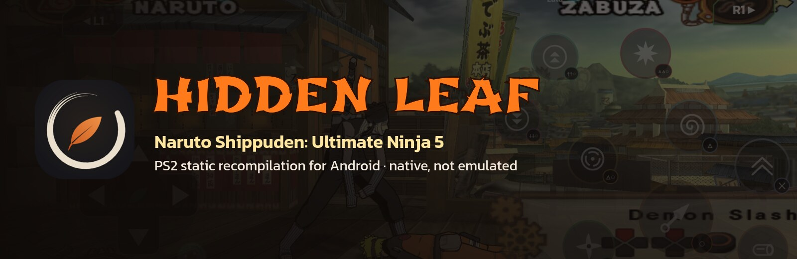
</p>

<p align="center">
  <a href="https://github.com/dfdx047/HiddenLeaf/releases"></a>
  <a href="https://github.com/dfdx047/HiddenLeaf/releases"></a>
  
  
  
</p>

<p align="center">
  <a href="README.md">English</a> · <b>Português</b> · <a href="README.es.md">Español</a>
  <br>
  <a href="CHANGELOG.pt-BR.md">Changelog</a> · <a href="https://github.com/dfdx047/HiddenLeaf/releases">Versões</a>
</p>

O **Hidden Leaf** roda *Naruto Shippuden: Ultimate Ninja 5* (PlayStation 2) de forma nativa no Android. O código do
próprio jogo foi **recompilado estaticamente** de MIPS para ARM64 com o [PS2Recomp](https://github.com/ran-j/PS2Recomp):
não existe CPU emulada, o jogo roda como um app Android. Por cima vem um launcher feito para celulares e portáteis,
controles por toque feitos para este jogo, mods e **jogo online**: salas, partida rápida e Wi-Fi local, escolhidos no
próprio menu do jogo.

> [!IMPORTANT]
> Projeto de fã, sem ligação com a Bandai Namco ou a CyberConnect2. **O app não traz nenhum dado do jogo** (nem imagem
> do disco, modelos, texturas, sons, vozes ou filmes). Você precisa da sua própria cópia da versão europeia,
> *Naruto Shippuden: Ultimate Ninja 5* (SLES-55605), em ISO.

## Imagens

<p align="center">
  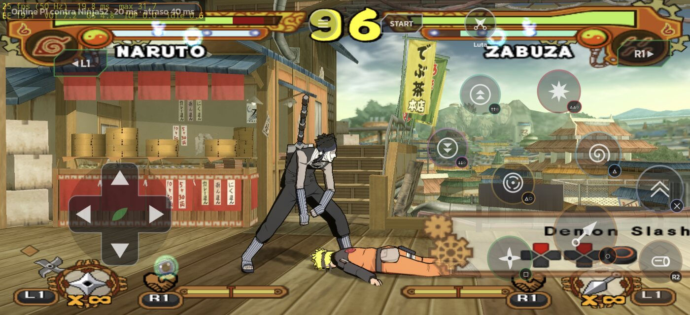
  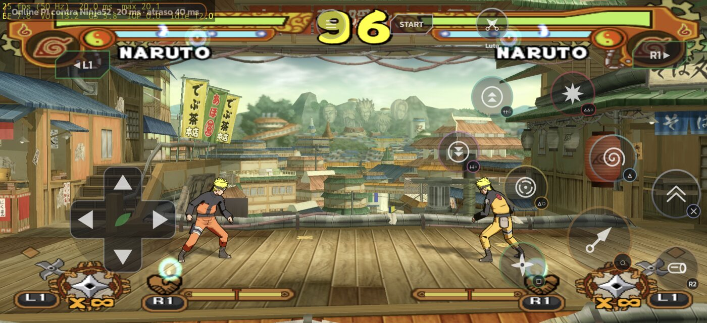
  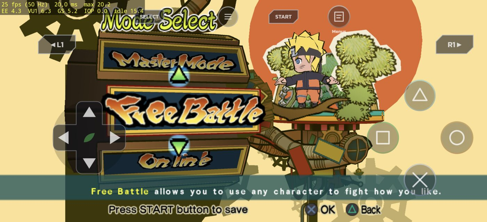
  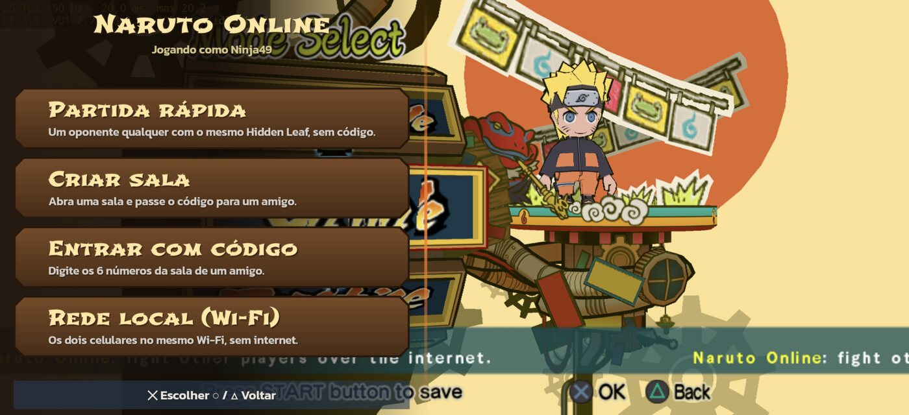
  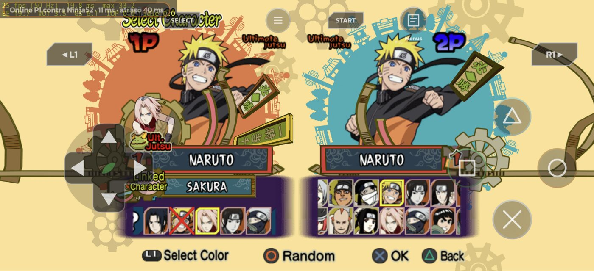
  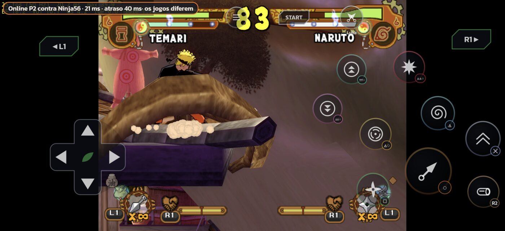
</p>

**Mods** (Ultimate Ninja 6 Alpha 1.1X):

<p align="center">
  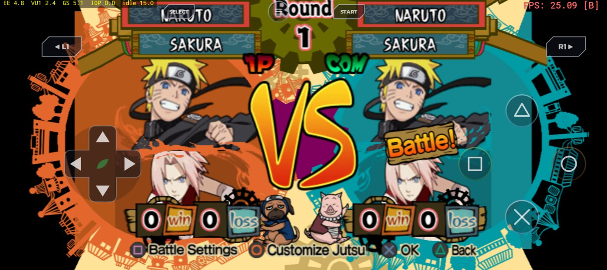
  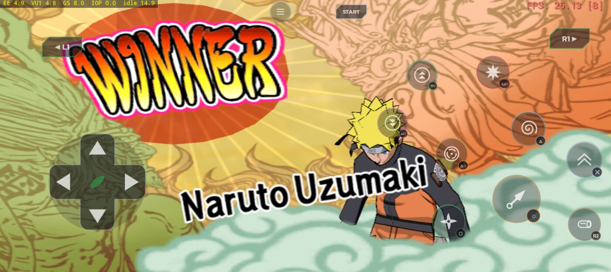
</p>

**Launcher e controles:**

<p align="center">
  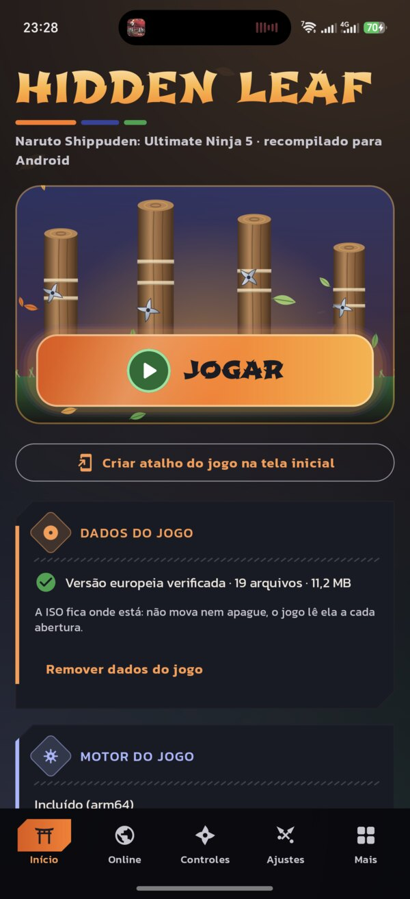
  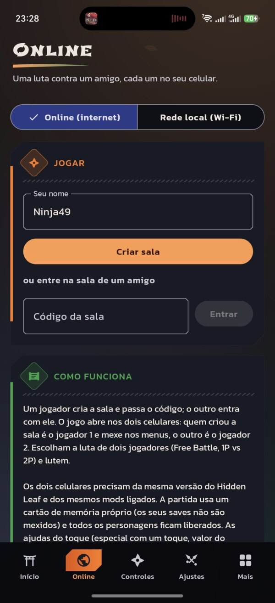
  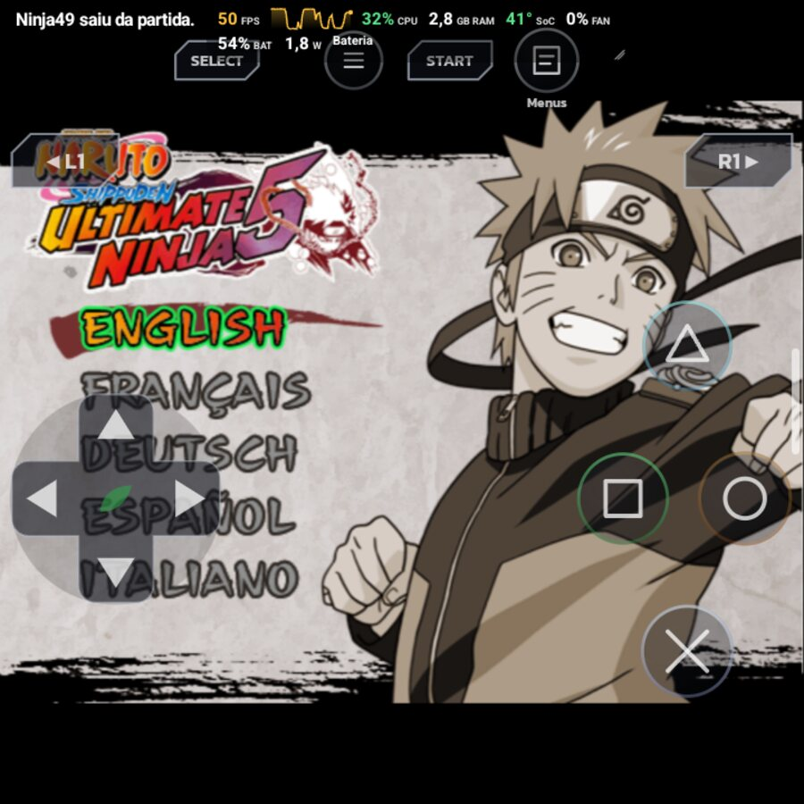
</p>
<p align="center">
  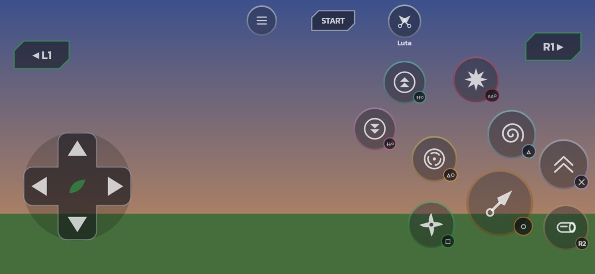
  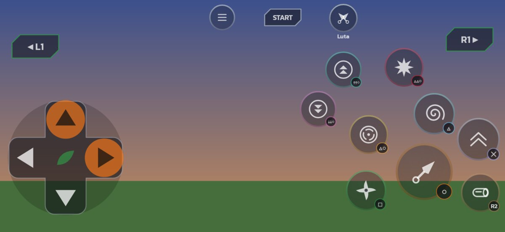
  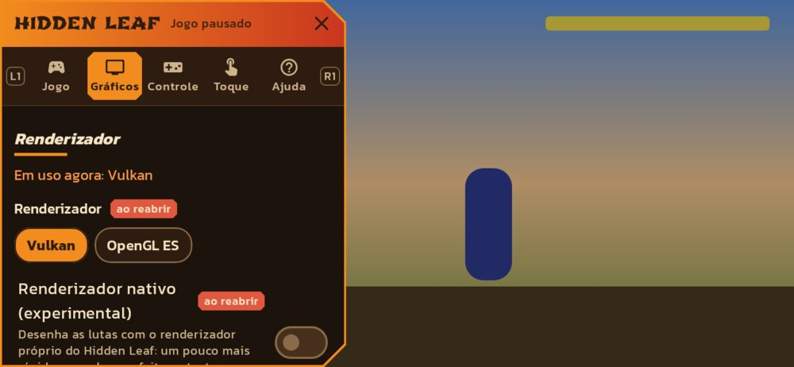
  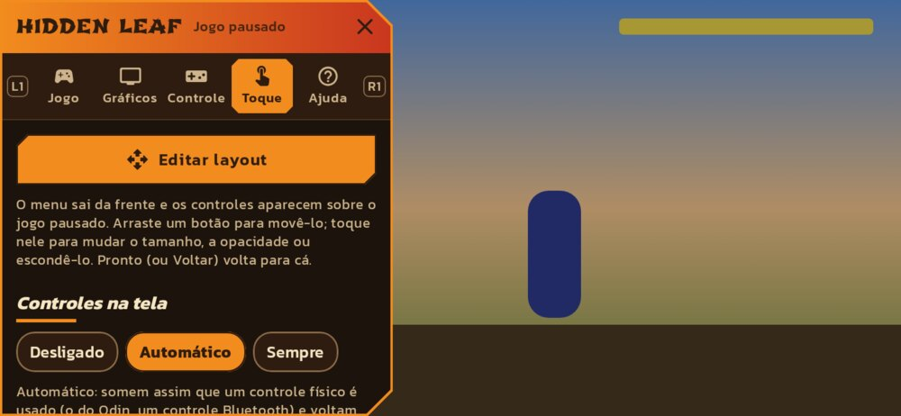
</p>

## O que tem

- **Nativo, não emulado.** O ELF do jogo e os overlays de `PRG/` (luta, aventura, menus, textos) rodam como código
  ARM64. As lutas rodam nos 50 fps do PS2; em celulares da classe do Snapdragon 665, o modo leve abre espaço para isso.
- **Dois motores num APK só:** ARMv8.2-A para os chips novos e ARMv8.0-A para os antigos (classe Snapdragon 625/665); o
  app escolhe o que serve.
- **Gráficos:** o GS do PS2 do ARMSX2/PCSX2 sobre Vulkan ou OpenGL ES, resolução interna de 0,5x a 8x, **Widescreen
  (16:9)** e **Ultrawide (20:9)** nas lutas, na campanha e nos menus sem esticar o HUD, 30/50 fps e 60/90/120 fps por
  interpolação, drivers Adreno personalizados (Turnip) baixados num toque e um **modo leve** para celulares mais fracos.
- **Controles por toque feitos para o Ultimate Ninja 5:** um layout por cena (luta, campanha, menus), especiais com um
  toque (↑↑○ e ↓↓○), Jutsu e Ougi num botão só, **Toque Pro** com direcional grande e fixo, macros, guia de botões e
  editor de layout (tamanho, posição e opacidade). Um controle físico é detectado e esconde os botões na tela; se ele
  desconecta, os botões voltam.
- **Menu lateral dentro do jogo** (sem sair do jogo): gráficos, mapa do controle, layout de toque e ajuda.
- **Online como no Dragon Rage, dentro do menu do jogo:** o *Naruto Online* fica na Mode Select, abaixo do Free Battle.
  O painel abre ao lado do Naruto animado, com a música tocando, e funciona por toque ou controle:
  - **Partida rápida:** qualquer outro jogador com a mesma versão do Hidden Leaf, sem código.
  - **Criar sala / Entrar com código:** um código de 6 números para um amigo.
  - **Rede local (Wi-Fi):** dois celulares no mesmo Wi-Fi ou hotspot, sem internet.
  - Os dois celulares vão direto para a seleção de personagem (1P e 2P), sem som e acelerados pelos menus. Quem criou
    escolhe o cenário e os menus; quem entrou controla o 2P.
  - Lockstep com atraso de entrada por conexão direta (STUN), com relay quando a conexão direta não dá.
- **Mods:** importe a ISO de um mod e o app guarda só os arquivos que diferem do jogo base. Mods conhecidos:
  **Ultimate Ninja 6 (Alpha 3.5)** com o pacote de código recompilado dele, **Ultimate Ninja 6 (Alpha 1.1X)** e a
  **Versão Brasileira**.
- **Launcher:** conferência da ISO por SHA-256, gerenciador de cartão de memória (importar e exportar `.ps2` com
  backup), cheats (desbloqueios gravados no save), pular a abertura, atalho na tela inicial, português, inglês e espanhol.

## Instalar e jogar

1. Baixe o `HiddenLeaf-v0.1.0-beta.apk` em [Versões](https://github.com/dfdx047/HiddenLeaf/releases) e instale
   (Android 10 ou mais novo, ARM de 64 bits).
2. Abra o Hidden Leaf, toque em **Selecionar ISO** e escolha o seu *Naruto Shippuden: Ultimate Ninja 5* (Europa,
   SLES-55605). O app confere e copia só os arquivos pequenos de boot; o resto é lido da ISO onde ela está.
3. Toque em **Jogar**.
4. Online: no jogo, *Free Battle* → *Naruto Online*. Os dois jogadores precisam da mesma versão do Hidden Leaf e do jogo
   base (sem mods).

Opcional: na página **Mods**, importe a ISO de um mod suportado e ligue-o.

## Como funciona

```
sua ISO   ──► SYSTEM.CNF, ELF, overlays de PRG/        (lidos no celular, nunca distribuídos)
                 │
PS2Recomp ──► C++ para cada função MIPS do ELF e de cada overlay
                 │                  (8158 funções no ELF; BTL 2832, ADV 3679, ETC 253; 0 erros)
NDK clang ──► libun5.so  (arm64, ARMv8.2 e ARMv8.0)  +  pacotes de código dos mods
                 │
runtime   ──► threads e escalonador do EE, módulos do IOP, SIF/RPC, DMA, VIF1/VU1, som do SPU2,
              filmes MPEG, controle, cartão de memória, leitura do disco direto da ISO
                 │
GS        ──► o GS do ARMSX2/PCSX2 (Vulkan / GLES); renderizador nativo da luta opcional
```

- **Recompilação.** O `tools/un5.py prepelf` divide a seção única do ELF em código e dados para o recompilador ver só
  funções de verdade; os overlays são recompilados como módulos próprios e achados em tempo de execução pelos bytes na
  memória.
- **Runtime.** O runtime do PS2Recomp, estendido para este jogo: módulos reais do IOP (`libsd`, `sdr_driver`,
  `modmidi`, `modhsyn`, `cdvdstm`), tempo de leitura do disco, a organização do heap do PS2, o arredondamento da FPU do
  EE, threads presas pela velocidade dos núcleos, o IOP e o SPU2 numa thread própria.
- **Conferido contra o PCSX2.** Uma bancada roda a mesma rota de botões no PCSX2 e no jogo recompilado e compara
  estruturas da RAM, o fluxo do GS e os quadros, luta por luta.
- **VU1.** Por padrão a VU1 do runtime; no modo leve, os blocos de VU1 recompilados do **Nominum-Render** (nosso
  renderizador nativo de PS2 para recomps).
- **Mods.** O `tools/un5.py diff` compara o código de um mod com o da base, função por função. Um mod de dados roda no
  motor base; um mod que muda o código ganha um pacote de código (o UN6 Alpha 3.5 muda cerca de 630 funções e
  acrescenta cerca de 770).
- **Online.** O jogo é determinístico para as mesmas entradas, então os dois celulares rodam o jogo inteiro e trocam só
  os botões, em lockstep com um atraso pequeno. As salas e a partida rápida ficam num Cloudflare Worker com banco D1; a
  conexão é direta (STUN, UDP), com relay de reserva. No Wi-Fi, os celulares se acham por broadcast. A entrada na
  partida (boot, menus, seleção de personagem) é acelerada e sem som nos dois celulares.

## Nossa trajetória

| Quando | O que aconteceu |
|---|---|
| 25/10/2026 | Início: launcher a partir do modelo do Dragon Rage, análise do ELF e dos overlays, linha de recompilação. A primeira execução no PC chegou ao boot do IOP. |
| 25–26/10 | Módulos do IOP carregados de verdade, busca de arquivos no disco, filmes com FFmpeg, matemática da VU0/VU1, vblank PAL de 50 Hz. A tela de título desenha (a causa era o `DI` ignorado). |
| 01/11 | Primeira execução no Android: GS do PCSX2 sobre Vulkan, ISO lida pelo descritor de arquivo; som do SPU2; VIF1/VU1/GIF numa thread própria; renderizador nativo da luta. Lutas a 50 fps. |
| 02–03/11 | Painel de pausa, widescreen, 60/120 fps interpolados, gerenciador de cartão de memória, mods sobre a imagem do disco e pacotes de código; o UN6 Alpha 3.5 luta no RG Cube. |
| 04–05/11 | Nominum-Render testado nos aparelhos, dumps do VIF, libsdr recompilada, som dos filmes em ordem, travamento do Ougi corrigido; A35 e Alpha 1.1X em três aparelhos. |
| 08–09/11 | Bancada contra o PCSX2: arredondamento, rand, tempo do disco e envios do PATH3 iguais aos do PS2. Menus por toque, menus em 20:9, motor ARMv8.0, heap igual ao do PS2. |
| 10–11/11 | IOP em blocos pré-decodificados, ajustes no Mi A3 (Snapdragon 665), nomes Widescreen/Ultrawide, 0,5x e 0,75x. |
| 12/11 | GS como renderizador padrão, launcher com cinco páginas, cheats, Toque Pro, menu lateral, serviço de salas online (Cloudflare Worker + D1) e lockstep no motor. |
| 13/11 | Modo leve (VU1 do Nominum + GS dividido), ícone novo, despertar da Hinata corrigido, jogo em Wi-Fi local, partida rápida. |
| 14/11 | A entrada na partida pelo lockstep, *Naruto Online* na Mode Select do jogo, lutas inteiras online pela rede local e pela internet. **v0.1.0-beta.** |

O registro completo, build por build, está em [docs/registro.md](docs/registro.md).

## Aparelhos testados

Celulares Honor e Poco (20:9), Xiaomi Mi A3 (Snapdragon 665), Anbernic RG Cube (Mali, 1:1), AYN Odin 2 Mini, AYN Odin 3
(120 Hz) e Retroid Pocket 5 (Snapdragon 865). O online foi testado Honor × Poco pela internet (salas, código, partida
rápida) e pelo Wi-Fi local.

## Problemas conhecidos

- **Beta.** Alguns efeitos ainda podem diferir do PS2; o modo leve pode perder ou piscar alguns efeitos.
- **Pacotes de textura** podem ser instalados, mas o jogo ainda não os usa.
- **O online é só para o jogo base** (sem mods) e pede a mesma versão do Hidden Leaf nos dois celulares. O servidor
  gratuito tem uma cota diária; quando ela acaba, a página inicial avisa quando volta (meia-noite UTC). O Wi-Fi local não
  usa o servidor.
- Mods que mudam o código só rodam com o pacote de código deles (hoje: UN6 Alpha 3.5).

Bugs e logs: abra uma [issue](https://github.com/dfdx047/HiddenLeaf/issues). A página *Depuração* salva um log para
enviar.

## Compilar

O motor é gerado a partir do seu próprio ELF; nada do jogo entra neste repositório.

```sh
# PC (Linux): ISO → disco extraído → ELF dividido → PS2Recomp → código gerado → runtime
recomp/build.sh <sua ISO europeia do UN5> --run

# Motor do Android (libun5.so; HL_V80=1 para o ARMv8.0; --mod <id> para o pacote de código de um mod)
recomp/android/build.sh
HL_V80=1 recomp/android/build.sh

# Launcher
cd android && ./gradlew assembleRelease
```

Ferramentas: `tools/un5.py` (`verify`, `extract`, `overlays`, `diff`, `unpack`, `prepelf`, `ovlelf`),
`tools/ramdiff.py`, `tools/vifdump.py`. Notas técnicas: [docs/plano.md](docs/plano.md),
[docs/analise-elf.md](docs/analise-elf.md), [docs/online.md](docs/online.md).

## Créditos

- [PS2Recomp](https://github.com/ran-j/PS2Recomp), de ran-j: o recompilador estático e o runtime dele.
- [ARMSX2](https://github.com/ARMSX2/ARMSX2) e [PCSX2](https://github.com/PCSX2/pcsx2): o renderizador do GS e a
  referência contra a qual tudo é conferido.
- **Nominum-Render**: nosso renderizador nativo de PS2 para recomps (VU1 e VIF1).
- [Dragon Rage](https://github.com/dfdx047/Tenkaichi3DecompAndroid): o modelo do launcher e o desenho do online.
- [SDL3](https://github.com/libsdl-org/SDL), [FFmpeg](https://ffmpeg.org), [ReLinker](https://github.com/KeepSafe/ReLinker),
  Jetpack Compose, Cloudflare Workers e D1.
- As equipes dos mods UN6 e Versão Brasileira, pelos mods que os jogadores podem importar.

*Naruto* é © Masashi Kishimoto / Shueisha, TV Tokyo, Pierrot. *Naruto Shippuden: Ultimate Ninja 5* é © Bandai Namco
Entertainment e CyberConnect2. Todas as marcas pertencem aos seus donos.
